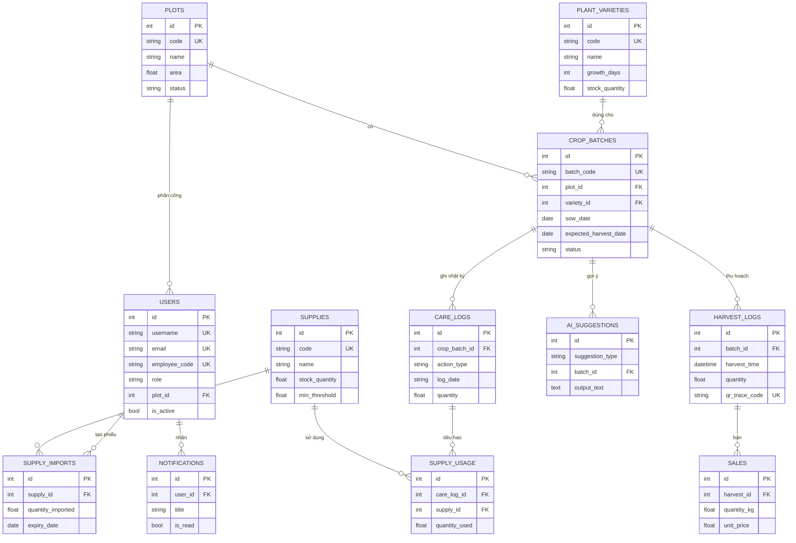

# FACT SHEET — GreenFarm AI

**Ngày đối chiếu:** 29/10/2026  
**Thư mục dự án:** `D:\Project AI SChoool\farm_backend`  
**Mục đích:** cung cấp dữ kiện đã kiểm tra từ mã nguồn, CSDL `farm.db` và các lần chạy thật, làm nền cho báo cáo, ERD, sơ đồ lớp, sơ đồ tuần tự và phần vấn đáp.

**Quy ước bằng chứng**

- “Đã chạy” = có lệnh/kết quả thật trong `docs/evidence/KIEM_CHUNG_THUC_TE.md` hoặc vừa chạy lại ngày 29/10/2026.
- “Đọc mã” = kết luận từ file/hàm được chỉ rõ, chưa nhất thiết gọi endpoint.
- Không có số liệu ước lượng nào được ghi như số liệu đo.
- Không in giá trị `GEMINI_API_KEY`, mật khẩu hay token.

---

## 0. Ảnh chụp nhanh để đối chiếu

| Hạng mục | Giá trị đã kiểm tra | Cách kiểm tra |
|---|---|---|
| Tổng route FastAPI | **197 route entry** | Duyệt `app.main:app.routes`, gồm router lồng `_IncludedRouter` |
| Đường dẫn duy nhất | **127** | Chuẩn hóa method + path |
| Đường dẫn canonical (không `/api/v1`, không dấu `/` cuối) | **60** | Lọc alias |
| Hàm xử lý duy nhất | **55** | Tên handler |
| Bảng CSDL | **12 bảng nghiệp vụ** + `alembic_version` | `sqlite_master`, `PRAGMA table_info` |
| Migration Alembic | **7 file migration** | `alembic/versions/*.py` |
| Test backend | **18 passed, 77 warnings, 4,12 s** | `venv/Scripts/python.exe -m pytest tests -q` ngày 29/10/2026 |
| Trạng thái CSDL | `integrity_check = ok` | `PRAGMA integrity_check` |
| Khóa ngoại khi chạy | `PRAGMA foreign_keys = 0` | Kiểm tra trực tiếp trên `farm.db` |
| Phiên bản CSDL | `alembic_version = 48c254cd80ae` | Truy vấn SQLite |

---

## 1. Mục đích, vai trò người dùng và ma trận quyền

### 1.1. Mục đích hệ thống

GreenFarm AI là ứng dụng web quản lý trang trại rau sạch, gồm:

- Quản lý tài khoản, lô đất, giống cây, lô trồng.
- Lập kế hoạch gieo trồng và theo dõi trạng thái sinh trưởng.
- Ghi nhật ký chăm sóc (tưới, bón phân, kiểm tra sâu bệnh, thu hoạch).
- Quản lý vật tư, nhập kho, trừ tồn kho và cảnh báo tồn thấp/hết hạn.
- Ghi nhận thu hoạch, truy xuất nguồn gốc bằng mã lô/mã QR.
- Thống kê, xuất Excel phục vụ báo cáo.
- Tích hợp AI: sinh lịch chăm sóc, tóm tắt nhật ký, gợi ý lô cần kiểm tra, hỏi đáp có dẫn nguồn.

### 1.2. Vai trò

| Vai trò | Giá trị lưu trong JWT/Enum | Phạm vi chính |
|---|---|---|
| Quản trị viên | `admin` | Toàn hệ thống; được bypass mọi kiểm tra quyền |
| Quản lý | `manager` | Quản lý trang trại, nhân sự, vật tư, lô trồng, thu hoạch |
| Kỹ thuật viên | `technician` | Lô trồng, nhật ký, thu hoạch, AI lịch/cảnh báo |
| Nhân viên | `staff` (UI gọi Worker) | Xem dữ liệu, ghi nhật ký trong lô được phân công, hỏi AI |
| Người tiêu dùng | Không đăng nhập | Chỉ xem trang truy xuất công khai |

> Ghi chú kỹ thuật: Enum `UserRole` lưu giá trị chữ thường (`admin`, `manager`, `technician`, `staff`); SQLite hiển thị tên Enum in hoa (`ADMIN`, …). Khi tạo JWT, `user.role.value` trả về chữ thường nên so sánh role ở frontend/backend khớp nhau.

### 1.3. Ma trận quyền trung tâm — 36 khóa

Nguồn: `app/core/permissions.py`, biến `PERMISSIONS_MATRIX`. Ký hiệu: A = admin, M = manager, T = technician, S = staff.

| Khóa quyền | A | M | T | S |
|---|---:|---:|---:|---:|
| `plots:read` | ✓ | ✓ | ✓ | ✓ |
| `plots:create` | ✓ | ✓ |  |  |
| `plots:update` | ✓ | ✓ |  |  |
| `plots:delete` | ✓ | ✓ |  |  |
| `plots:assign` | ✓ | ✓ |  |  |
| `plant_varieties:read` | ✓ | ✓ | ✓ | ✓ |
| `plant_varieties:create` | ✓ | ✓ |  |  |
| `plant_varieties:update` | ✓ | ✓ |  |  |
| `plant_varieties:delete` | ✓ | ✓ |  |  |
| `crop_batches:read` | ✓ | ✓ | ✓ | ✓ |
| `crop_batches:create` | ✓ | ✓ | ✓ |  |
| `crop_batches:update` | ✓ | ✓ | ✓ |  |
| `crop_batches:delete` | ✓ | ✓ | ✓ |  |
| `care_logs:read` | ✓ | ✓ | ✓ | ✓ |
| `care_logs:create` | ✓ | ✓ | ✓ | ✓ |
| `care_logs:update` | ✓ | ✓ | ✓ |  |
| `care_logs:approve` | ✓ | ✓ | ✓ |  |
| `care_logs:delete` | ✓ | ✓ | ✓ |  |
| `supplies:read` | ✓ | ✓ | ✓ | ✓ |
| `supplies:report` | ✓ | ✓ | ✓ | ✓ |
| `supplies:create` | ✓ | ✓ |  |  |
| `supplies:update` | ✓ | ✓ |  |  |
| `supplies:delete` | ✓ | ✓ |  |  |
| `supplies:approve` | ✓ | ✓ |  |  |
| `harvests:read` | ✓ | ✓ | ✓ | ✓ |
| `harvests:create` | ✓ | ✓ | ✓ |  |
| `harvests:update` | ✓ | ✓ | ✓ |  |
| `harvests:delete` | ✓ | ✓ |  |  |
| `traceability:read` | ✓ | ✓ | ✓ | ✓ |
| `traceability:create` | ✓ | ✓ | ✓ |  |
| `ai:ask` | ✓ | ✓ | ✓ | ✓ |
| `ai:schedule` | ✓ | ✓ | ✓ |  |
| `users:read` | ✓ | ✓ |  |  |
| `users:create` | ✓ | ✓ |  |  |
| `users:update` | ✓ | ✓ |  |  |
| `users:delete` | ✓ | ✓ |  |  |

**Cách thi hành**

- `RequireRole([...])` dùng cho nhóm route auth, supply, AI schedule/alert.
- `require_permission("key")` dùng cho plots, varieties, batches, care logs, harvests.
- Admin bypass: `ADMIN_ROLES = {"admin", "administrator", "quan_tri_vien"}`.
- Nhân viên bị giới hạn theo `plot_id` ở: danh sách lô trồng, danh sách/ghi nhật ký, AI advisor chat, AI summary kiểu cũ trong trang nhật ký.
- **Lỗ hổng đã xác định:** `/search` và `/api/notifications` không yêu cầu đăng nhập; `POST /api/ai-summary/...` và `POST /api/v1/ai-advisor/summary` không lọc theo lô của staff; danh sách thu hoạch không lọc theo lô.

---

## 2. Danh sách chức năng FR-xx và yêu cầu phi chức năng NFR-xx

### 2.1. Chức năng (FR)

| Mã | Chức năng | Vai trò | Cài đặt chính | Trạng thái |
|---|---|---|---|---|
| FR-01 | Đăng nhập bằng email/tên đăng nhập/mã nhân viên, cấp JWT | Tất cả tài khoản | `app/routers/auth.py::login`, `app/core/security.py` | Đủ |
| FR-02 | Quản lý tài khoản, khóa/mở, đổi mật khẩu, reset mật khẩu | A/M; người dùng tự đổi mật khẩu | `auth.py::register/list_users/update_user/update_user_status/delete_user/reset_user_password` | Đủ |
| FR-03 | CRUD lô đất, gán trạng thái canh tác | Đọc: tất cả; ghi: A/M | `app/routers/plot.py` | Đủ |
| FR-04 | CRUD giống cây, định mức sinh trưởng, tồn kho giống | Đọc: tất cả; ghi: A/M | `app/routers/plant_variety.py` | Đủ |
| FR-05 | Tạo/sửa/xóa lô trồng; trừ/hoàn tồn kho giống | Đọc: tất cả (staff theo lô); ghi: A/M/T | `app/routers/crop_batch.py`, `app/services/crop_batch_service.py` | Đủ |
| FR-06 | Ghi nhật ký chăm sóc, lọc theo lô, xóa nhật ký | Đọc/ghi: tất cả; xóa: A/M/T | `app/routers/care_log.py` | Đủ |
| FR-07 | Tải ảnh nhật ký (JPEG/PNG/WebP, tối đa 5 MB) | Người có `care_logs:create` | `care_log.py::upload_care_log_image` | Đủ |
| FR-08 | CRUD vật tư, nhập kho, cảnh báo tồn thấp/hết hạn | Đọc: tất cả; ghi: A/M | `app/routers/supply.py`, `app/services/supply.py` | Đủ |
| FR-09 | Trừ tồn vật tư khi ghi nhật ký, tạo thông báo tồn thấp | Người ghi nhật ký | `care_log.py` + `supply.py::deduct_supply_stock` | Đủ |
| FR-10 | Ghi nhận thu hoạch, sinh mã QR, xem theo lô | A/M/T tạo; tất cả xem | `app/routers/harvest.py`, `app/services/harvest.py` | **Thiếu — POST lỗi 500** |
| FR-11 | Truy xuất nguồn gốc công khai theo mã lô | Công khai | `app/routers/traceability.py`, `crop_batch.py` trace | Đủ |
| FR-12 | Dashboard sản lượng, xuất báo cáo Excel | Tất cả tài khoản | `app/routers/dashboard.py`, `frontend/app/(dashboard)/data-reports/page.tsx` | Một phần |
| FR-13 | AI sinh lịch chăm sóc theo giống + ngày gieo | A/M/T | `app/services/ai_schedule.py` | Đủ |
| FR-14 | AI tóm tắt nhật ký theo lô | A/M/T/S | `app/services/ai_summary.py` | Đủ |
| FR-15 | AI xếp hạng lô cần kiểm tra | A/M/T | `app/services/ai_alert.py` | Một phần — trả 0 lô trên dữ liệu hiện tại |
| FR-16 | AI hỏi đáp theo ngữ cảnh lô, có citations | A/M/T/S | `app/routers/ai_advisor.py` | Đủ |
| FR-17 | Thông báo trong ứng dụng, tìm kiếm toàn cục | Công khai (hiện tại) | `notification.py`, `search.py` | Một phần — thiếu auth, tìm kiếm hẹp |
| FR-18 | Bán sản phẩm | Chưa có UI | `app/models/sale.py`, `app/services/sale.py`, `app/routers/sale.py` | **Thiếu — router không được mount** |

### 2.2. Yêu cầu phi chức năng (NFR)

| Mã | Yêu cầu | Bằng chứng | Đánh giá |
|---|---|---|---|
| NFR-01 | Hiệu năng đọc tốt, tránh N+1 | Index ở các cột lọc; `selectinload`/`joinedload`; đo trung vị 8,7–14,8 ms cho 9 API đọc chính (KIEM_CHUNG mục 6) | Đủ |
| NFR-02 | Xác thực và phân quyền | JWT HS256, PBKDF2-SHA256, `require_permission`, `RequireRole`, kiểm tra `is_active` | Đủ, còn lỗ hổng ở mục 1.3 |
| NFR-03 | Kiểm tra dữ liệu đầu vào | Pydantic 2 với `Field`, `model_validator`, `strict`, `extra="forbid"` | Đủ |
| NFR-04 | Toàn vẹn dữ liệu | Unique/NOT NULL ở model; **FK enforcement đang tắt khi chạy** | Một phần |
| NFR-05 | AI không bịa dữ liệu | `ANTI_HALLUCINATION_INSTRUCTIONS`, kiểm tra ID/mã lô, tự tính ngày | Đủ |
| NFR-06 | AI lỗi vẫn có phản hồi | Mapping 429/504/502/503; fallback 200 cho summary | Đủ, advisor không fallback |
| NFR-07 | Bảo mật bí mật | `.env` bị ignore; nhưng key thật có trong lịch sử Git; `SECRET_KEY` có giá trị mặc định | **Thiếu** |
| NFR-08 | Khả năng bảo trì | Kiến trúc router → service → repository → model; alias API tương thích | Đủ |
| NFR-09 | Khả năng triển khai | README, Docker Compose, Vercel config; nhưng Docker backend cài từ `requirements.txt` rỗng | Một phần |
| NFR-10 | Kiểm thử | 18 test pass; thiếu test thu hoạch, AI schedule/summary/alert, biên | Một phần |
| NFR-11 | Giao diện tiếng Việt, responsive | 12 trang Next.js, Tailwind, sidebar, dark mode | Đủ |

---

## 3. Danh sách API

### 3.1. Cách đếm và alias

- **197 route entry** do cùng một handler được mount ở nhiều prefix: `/api/...`, `/api/v1/...`, có/không dấu `/` cuối.
- **127 path duy nhất**, **55 handler duy nhất**.
- Các nhóm alias chính:
  - Lô trồng: `/api/batches`, `/api/crop-batches`, `/api/crop-lots`, `/api/v1/...`.
  - Nhật ký: `/api/care-logs`, `/api/logs`, `/api/v1/...`.
  - Giống: `/api/varieties`, `/api/crop-varieties`, `/api/plant-varieties`, `/api/v1/...`.
  - Lô đất: `/api/plots`, `/api/land-plots`, `/api/v1/...`.
  - Thu hoạch: `/api/harvests`, `/api/v1/harvests`.
- Bảng dưới liệt kê **đường dẫn canonical** (ưu tiên dạng không `/v1`); alias tương đương không lặp lại.

### 3.2. Bảng API theo module

Ký hiệu vai trò: **CK** = công khai; **ĐN** = đã đăng nhập (mọi vai trò); **A/M** = admin hoặc manager; **A/M/T** = thêm technician; **A/M/T/S** = cả bốn vai trò.

#### Xác thực và tài khoản

| Method | Đường dẫn | Vai trò | Mô tả |
|---|---|---|---|
| POST | `/api/auth/login` | CK | Nhận form `username` + `password`, trả JWT và hồ sơ người dùng |
| GET | `/api/auth/me` | ĐN | Trả hồ sơ từ token, đã truy vấn lại DB |
| POST | `/api/auth/me/password` | ĐN | Đổi mật khẩu, kiểm tra mật khẩu cũ |
| POST | `/api/auth/register` | A/M | Tạo tài khoản; manager không được tạo admin/manager |
| GET | `/api/auth/users` | A/M | Danh sách tài khoản kèm tên lô đất |
| PUT | `/api/auth/users/{user_id}` | A/M | Sửa họ tên, email, vai trò, lô đất |
| PATCH | `/api/auth/users/{user_id}/status` | A/M | Khóa/mở tài khoản |
| DELETE | `/api/auth/users/{user_id}` | A/M | Xóa tài khoản |
| POST | `/api/auth/users/{user_id}/reset-password` | A/M | Đặt lại mật khẩu |

#### Lô đất

| Method | Đường dẫn | Vai trò | Mô tả |
|---|---|---|---|
| GET | `/api/plots` | ĐN | Danh sách lô đất; staff chỉ thấy lô được phân công |
| POST | `/api/plots` | A/M | Tạo lô đất |
| PUT | `/api/plots/{plot_id}` | A/M | Cập nhật lô đất |
| DELETE | `/api/plots/{plot_id}` | A/M | Xóa lô đất |
| POST | `/api/plots/{plot_id}/start-planting` | A/M | Đổi trạng thái lô sang “Đang canh tác”; **không lưu** ngày gieo/ngày thu hoạch vào bảng `plots` |

#### Giống cây

| Method | Đường dẫn | Vai trò | Mô tả |
|---|---|---|---|
| GET | `/api/varieties` | ĐN | Danh sách giống |
| POST | `/api/varieties` | A/M | Tạo giống |
| GET | `/api/varieties/{variety_id}` | ĐN | Chi tiết giống |
| PUT | `/api/varieties/{variety_id}` | A/M | Cập nhật giống |
| DELETE | `/api/varieties/{variety_id}` | A/M | Xóa giống |

#### Lô trồng

| Method | Đường dẫn | Vai trò | Mô tả |
|---|---|---|---|
| GET | `/api/batches` | ĐN | Danh sách lô trồng; staff lọc theo `plot_id` |
| POST | `/api/batches` | A/M/T | Tạo lô, kiểm tra lô đất/giống, trừ tồn kho giống |
| PUT | `/api/batches/{batch_id}` | A/M/T | Cập nhật lô, cân đối lại tồn kho giống |
| DELETE | `/api/batches/{batch_id}` | A/M/T | Xóa lô, hoàn tồn kho giống |
| GET | `/api/batches/trace/{batch_code}` | CK | Truy xuất theo mã lô (shape của router lô trồng) |
| GET | `/api/batches/code/{code}/trace` | CK | Truy xuất theo mã lô (handler thứ hai) |

#### Nhật ký chăm sóc

| Method | Đường dẫn | Vai trò | Mô tả |
|---|---|---|---|
| GET | `/api/care-logs` | ĐN | Danh sách nhật ký; staff lọc theo lô được phân công |
| POST | `/api/care-logs` | ĐN | Tạo nhật ký, trừ vật tư, tạo thông báo, đồng bộ trạng thái lô |
| GET | `/api/care-logs/{batch_id}` | ĐN | Nhật ký theo lô |
| POST | `/api/care-logs/upload` | ĐN | Upload ảnh JPEG/PNG/WebP ≤ 5 MB |
| DELETE | `/api/care-logs/{log_id}` | A/M/T | Xóa một nhật ký |
| DELETE | `/api/care-logs/range` | A/M/T | Xóa nhật ký theo khoảng ngày |
| POST | `/api/care-logs/{batch_id}/ai-summary` | ĐN | Tóm tắt AI kiểu cũ; staff bị giới hạn theo lô |

#### Thu hoạch

| Method | Đường dẫn | Vai trò | Mô tả |
|---|---|---|---|
| GET | `/api/harvests` | ĐN | Danh sách tất cả lượt thu hoạch; **không lọc theo lô của staff** |
| GET | `/api/harvests/batch/{batch_id}` | ĐN | Danh sách thu hoạch theo lô |
| POST | `/api/harvests` | A/M/T | Tạo lượt thu hoạch; **hiện lỗi 500** do schema/service lệch trường |
| GET | `/api/harvests/trace/{trace_code}` | CK | Tra cứu công khai theo mã QR |

#### Vật tư

| Method | Đường dẫn | Vai trò | Mô tả |
|---|---|---|---|
| GET | `/api/supplies` | ĐN | Danh sách vật tư, lọc loại/tìm kiếm/tồn thấp |
| GET | `/api/supplies/{supply_id}` | ĐN | Chi tiết vật tư |
| GET | `/api/supplies/alerts` | ĐN | Cảnh báo tồn thấp và hạn dùng trong 30 ngày |
| POST | `/api/supplies` | A/M | Tạo vật tư, có thể kèm tồn/hạn ban đầu |
| PUT | `/api/supplies/{supply_id}` | A/M | Cập nhật vật tư |
| DELETE | `/api/supplies/{supply_id}` | A/M | Xóa vật tư |
| POST | `/api/supplies/{supply_id}/import` | A/M | Nhập kho, cộng tồn, lưu lô/hạn dùng |

#### Dashboard, truy xuất, thông báo, tìm kiếm

| Method | Đường dẫn | Vai trò | Mô tả |
|---|---|---|---|
| GET | `/api/dashboard/harvest-chart` | ĐN | Chuỗi sản lượng theo ngày/tháng/năm |
| GET | `/api/traceability/{batch_code}` | CK | Truy xuất công khai, eager-load lô/giống/nhật ký/thu hoạch |
| GET | `/api/notifications` | **CK (thiếu auth)** | 20 thông báo mới nhất |
| GET | `/search` | **CK (thiếu auth)** | Tìm trong `HarvestLog.notes` |

#### AI

| Method | Đường dẫn | Vai trò | Mô tả |
|---|---|---|---|
| POST | `/api/ai-schedule/batches/{batch_id}/schedule` | A/M/T | Sinh lịch chăm sóc có kiểm chứng |
| POST | `/api/ai-summary/batches/{batch_id}/summary` | A/M/T/S | Tóm tắt theo ID trong URL |
| POST | `/api/ai-summary/summary` | A/M/T/S | Tóm tắt theo body `{batch_id | crop_batch_id | lot_id}` |
| POST | `/api/ai-alert/alerts` | A/M/T | Xếp hạng tối đa 5 lô cần kiểm tra |
| POST | `/api/v1/ai-advisor/chat` | A/M/T/S | Hỏi đáp có ngữ cảnh DB và citations |
| POST | `/api/v1/ai-advisor/summary` | A/M/T/S | Alias tóm tắt; **không lọc theo lô của staff** |

#### Khác

| Method | Đường dẫn | Vai trò | Mô tả |
|---|---|---|---|
| GET | `/health` | CK | Kiểm tra sống |
| GET | `/` | CK | Thông tin gốc của ứng dụng |

---

## 4. Kiến trúc và công nghệ

### 4.1. Kiến trúc logic

```text
Trình duyệt
  └─ Next.js 16 App Router (React 19, client components, SWR)
       ├─ gọi REST bằng fetch/axios, token trong localStorage/cookie
       └─ trang công khai /trace/[batch_code]
            │
            ▼
FastAPI (Uvicorn)
  ├─ routers/        nhận request, dependency auth/permission
  ├─ services/       nghiệp vụ, transaction, gọi AI
  ├─ repositories/   truy vấn SQLAlchemy
  ├─ models/         12 bảng ORM
  ├─ schemas/        Pydantic request/response
  ├─ core/           config, security, deps, permissions, ai_client
  └─ uploads/        ảnh nhật ký (app/uploads/care-logs)
            │
            ├─ SQLAlchemy 2 → SQLite farm.db (WAL)
            └─ google-genai → Gemini API (đồng bộ, không queue/retry)
```

**Đặc điểm kiến trúc**

- Monorepo: backend Python ở gốc, frontend Next.js trong `frontend/`.
- API đồng bộ; không có message queue, cache server hay worker nền.
- AI gọi trực tiếp trong request; lịch sử gợi ý lưu bảng `ai_suggestions`.
- Alias prefix được dùng để tương thích nhiều phiên bản frontend.
- Upload ảnh lưu filesystem cục bộ, không dùng object storage.

### 4.2. Phiên bản công nghệ (đo từ môi trường chạy `venv` và `frontend/node_modules`)

| Thành phần | Phiên bản |
|---|---|
| Python | 3.12.10 |
| FastAPI | 0.141.1 |
| Starlette | 1.6.0 |
| Uvicorn | 0.52.3 |
| SQLAlchemy | 2.0.52 |
| Pydantic | 2.13.4 |
| PyJWT | 2.13.0 |
| passlib | 1.7.4 |
| google-genai | 2.18.1 |
| Alembic | 1.20.0 |
| pytest | 9.2.0 |
| httpx | 0.28.1 |
| python-multipart | 0.0.32 |
| Node.js (máy chạy) | v24.18.1 |
| npm | 11.16.0 |
| Next.js | 16.4.3 |
| React / React DOM | 19.2.8 |
| TypeScript | 5.7.3 |
| Tailwind CSS | 4.3.3 |
| SWR | 2.5.1 |
| Recharts | 3.10.1 |
| motion | 12.43.0 |
| ExcelJS | 4.4.0 |
| lucide-react | 1.31.0 |
| @base-ui/react | 1.7.0 |
| qrcode.react | 4.2.0 |
| axios | 1.21.0 |
| CSDL | SQLite `farm.db`, journal WAL |
| AI provider | Google Gemini, model `gemini-2.5-flash` (viết cứng trong `ai_client.py`) |

> Có hai môi trường Python trong repo: `venv/` (3.12.10, dùng để chạy test và tài liệu này) và `.venv/` (3.10.11, chứa bộ package khác). Cần nêu rõ môi trường khi báo cáo để tránh lệch phiên bản.

### 4.3. Hiện trạng triển khai

- `docker-compose.yml` build backend từ `app/Dockerfile`, context là thư mục gốc.
- `app/Dockerfile` chạy `pip install -r requirements.txt`, nhưng `requirements.txt` ở gốc **rỗng 0 byte** → image backend không có dependency.
- Compose truyền `NEXT_PUBLIC_API_URL=http://localhost:8000/api/v1`; `frontend/lib/api.ts` lại tự thêm `/api` nếu URL chưa kết thúc bằng `/api` → tạo URL `/api/v1/api/...`, không khớp route.
- README hướng dẫn `pip install -r requirements.txt` và cấu hình `NEXT_PUBLIC_API_URL=http://localhost:8000/api/v1`, cùng chịu lỗi trên.
- `vercel.json` tồn tại nhưng chưa có bằng chứng deploy thành công trong lần kiểm tra này.

---

## 5. Cơ sở dữ liệu

### 5.1. Mười hai bảng

Nguồn: model SQLAlchemy + `PRAGMA table_info` trên `farm.db`. Cột ghi “PK” = khóa chính, “FK” = khóa ngoại, “U” = unique, “NN” = NOT NULL.

#### `users`

| Cột | Kiểu | Ràng buộc |
|---|---|---|
| `id` | INTEGER | PK |
| `username` | VARCHAR | NN, U |
| `email` | VARCHAR | NN, U |
| `hashed_password` | VARCHAR | NN |
| `full_name` | VARCHAR |  |
| `role` | VARCHAR(10) | NN, Enum `ADMIN/MANAGER/TECHNICIAN/STAFF` |
| `employee_code` | VARCHAR(50) | U |
| `plot_id` | INTEGER | FK → `plots.id`, ON DELETE SET NULL |
| `is_active` | BOOLEAN | NN, mặc định true |

#### `plots`

| Cột | Kiểu | Ràng buộc |
|---|---|---|
| `id` | INTEGER | PK |
| `code` | VARCHAR | NN, U |
| `name` | VARCHAR | NN |
| `area` | FLOAT | NN |
| `soil_type` | VARCHAR | mặc định “Đất thịt” |
| `location` | VARCHAR |  |
| `status` | VARCHAR | mặc định “Đang nghỉ” |
| `description` | VARCHAR |  |
| `cultivation_model` | VARCHAR(50) |  |
| `irrigation_systems` | JSON | NN, mặc định list rỗng |
| `ph_current` | FLOAT |  |
| `ec_ms_cm` | FLOAT |  |
| `previous_crop` | VARCHAR(150) |  |

#### `plant_varieties`

| Cột | Kiểu | Ràng buộc |
|---|---|---|
| `id` | INTEGER | PK |
| `code` | VARCHAR(50) | U |
| `name` | VARCHAR(150) | NN |
| `category` | VARCHAR(100) |  |
| `supplier` | VARCHAR(150) |  |
| `growth_days` | INTEGER |  |
| `germination_day` | INTEGER |  |
| `development_day` | INTEGER |  |
| `harvest_day` | INTEGER |  |
| `stock_quantity` | FLOAT | NN, mặc định 0 |
| `unit` | VARCHAR(50) |  |
| `expected_yield_value` | FLOAT |  |
| `expected_yield_unit` | VARCHAR(20) |  |
| `suitable_seasons` | JSON | NN |
| `ph_min`, `ph_max` | FLOAT |  |
| `temperature_min`, `temperature_max` | FLOAT |  |
| `air_humidity_min`, `air_humidity_max` | FLOAT |  |
| `soil_humidity_min`, `soil_humidity_max` | FLOAT |  |
| `status` | VARCHAR(30) | NN, mặc định `active` |
| `description` | TEXT |  |

#### `crop_batches`

| Cột | Kiểu | Ràng buộc |
|---|---|---|
| `id` | INTEGER | PK |
| `batch_code` | VARCHAR(50) | NN, U |
| `name` | VARCHAR(100) |  |
| `plot_id` | INTEGER | NN, FK → `plots.id` |
| `variety_id` | INTEGER | NN, FK → `plant_varieties.id` |
| `sow_date` | DATE |  |
| `expected_harvest_date` | DATE |  |
| `quantity` | FLOAT | mặc định 0 |
| `status` | VARCHAR(50) | mặc định “Đang trồng” |
| `planting_method` | VARCHAR(50) |  |
| `certification_standard` | VARCHAR(50) |  |
| `notes` | TEXT |  |

#### `care_logs`

| Cột | Kiểu | Ràng buộc |
|---|---|---|
| `id` | INTEGER | PK |
| `crop_batch_id` | INTEGER | FK → `crop_batches.id`, ON DELETE CASCADE |
| `batch_id` | INTEGER | **Cột legacy còn trong DB**, FK → `crop_batches.id`; model không ánh xạ |
| `action_type` | VARCHAR(100) | NN |
| `log_date` | VARCHAR(50) |  |
| `description` | TEXT |  |
| `notes` | TEXT |  |
| `image_url` | VARCHAR(255) |  |
| `created_by` | VARCHAR |  |
| `created_at` | DATETIME | server default now |
| `quantity` | FLOAT |  |
| `quality_percent` | FLOAT |  |

#### `harvest_logs`

| Cột | Kiểu | Ràng buộc |
|---|---|---|
| `qr_trace_code` | VARCHAR(100) | U |
| `id` | INTEGER | PK |
| `batch_id` | INTEGER | NN, FK → `crop_batches.id`, ON DELETE CASCADE |
| `harvest_time` | DATETIME | NN |
| `quantity` | FLOAT | NN |
| `unit` | VARCHAR | NN, mặc định `kg` |
| `grade` | VARCHAR | mặc định `loai_1` |
| `notes` | VARCHAR |  |

#### `sales`

| Cột | Kiểu | Ràng buộc |
|---|---|---|
| `id` | INTEGER | PK |
| `harvest_id` | INTEGER | NN, FK → `harvest_logs.id`, ON DELETE CASCADE |
| `customer_name` | VARCHAR |  |
| `quantity_kg` | FLOAT | NN |
| `unit_price` | FLOAT | NN |
| `sale_date` | DATE | NN |

#### `supplies`

| Cột | Kiểu | Ràng buộc |
|---|---|---|
| `id` | INTEGER | PK |
| `code` | VARCHAR(50) | U |
| `name` | VARCHAR | NN |
| `category` | VARCHAR(50) |  |
| `type` | VARCHAR |  |
| `unit` | VARCHAR | NN |
| `stock_quantity` | FLOAT | NN, mặc định 0 |
| `min_threshold` | FLOAT | NN, mặc định 0 |
| `location` | VARCHAR(150) |  |
| `status` | VARCHAR(30) | NN, mặc định `active` |
| `usage_notes` | VARCHAR(2000) |  |
| `storage_notes` | VARCHAR(2000) |  |

#### `supply_imports`

| Cột | Kiểu | Ràng buộc |
|---|---|---|
| `id` | INTEGER | PK |
| `supply_id` | INTEGER | NN, FK → `supplies.id`, ON DELETE CASCADE |
| `quantity_imported` | FLOAT | NN |
| `unit_price` | FLOAT | NN, mặc định 0 |
| `supplier_name` | VARCHAR(150) |  |
| `batch_number` | VARCHAR(100) |  |
| `manufacture_date` | DATE |  |
| `expiry_date` | DATE | có index |
| `imported_at` | DATETIME | NN |
| `created_by_user_id` | INTEGER | FK → `users.id` |

#### `supply_usage`

| Cột | Kiểu | Ràng buộc |
|---|---|---|
| `id` | INTEGER | PK |
| `care_log_id` | INTEGER | NN, FK → `care_logs.id` |
| `supply_id` | INTEGER | NN, FK → `supplies.id` |
| `quantity_used` | FLOAT | NN |
| `used_at` | DATETIME | NN |
| `notes` | VARCHAR(255) |  |

#### `ai_suggestions`

| Cột | Kiểu | Ràng buộc |
|---|---|---|
| `id` | INTEGER | PK |
| `suggestion_type` | VARCHAR | NN: `schedule`, `summary`, `alert` |
| `batch_id` | INTEGER | FK → `crop_batches.id` |
| `input_data` | TEXT |  |
| `output_text` | TEXT |  |
| `disclaimer` | VARCHAR | NN |
| `created_at` | DATETIME | NN |

#### `notifications`

| Cột | Kiểu | Ràng buộc |
|---|---|---|
| `id` | INTEGER | PK |
| `user_id` | INTEGER | FK → `users.id` |
| `type` | VARCHAR(50) |  |
| `title` | VARCHAR(255) |  |
| `message` | TEXT |  |
| `is_read` | BOOLEAN | mặc định false |
| `created_at` | DATETIME | server default now |

### 5.2. Quan hệ

- `plots (1) ── (N) users.plot_id` — người dùng được phân công một lô đất.
- `plots (1) ── (N) crop_batches.plot_id` — một lô đất có nhiều vụ/lô trồng.
- `plant_varieties (1) ── (N) crop_batches.variety_id` — một giống dùng cho nhiều lô trồng.
- `crop_batches (1) ── (N) care_logs.crop_batch_id` — nhật ký thuộc một lô trồng.
- `crop_batches (1) ── (N) harvest_logs.batch_id` — lượt thu hoạch thuộc một lô trồng.
- `harvest_logs (1) ── (N) sales.harvest_id` — một lượt thu hoạch có thể bán nhiều lần.
- `supplies (1) ── (N) supply_imports.supply_id` — các lô nhập kho của vật tư.
- `supplies (1) ── (N) supply_usage.supply_id` — các lần sử dụng vật tư.
- `care_logs (1) ── (N) supply_usage.care_log_id` — vật tư dùng trong một nhật ký.
- `users (1) ── (N) supply_imports.created_by_user_id` — người tạo phiếu nhập.
- `users (1) ── (N) notifications.user_id` — thông báo cho người dùng (có thể null = toàn trang trại).
- `crop_batches (1) ── (N) ai_suggestions.batch_id` — lịch sử gợi ý AI theo lô.

### 5.3. ERD dạng Mermaid



### 5.4. Dữ liệu thật ngày 29/10/2026

| Bảng | Số dòng |
|---|---:|
| `plots` | 7 |
| `users` | 9 |
| `plant_varieties` | 10 |
| `crop_batches` | 19 |
| `harvest_logs` | 12 |
| `sales` | 12 |
| `supplies` | 6 |
| `supply_imports` | 14 |
| `supply_usage` | 24 |
| `care_logs` | 63 |
| `ai_suggestions` | 36 lúc bắt đầu kiểm tra; 37 sau một lần gọi thử tóm tắt AI |
| `notifications` | 2 |

**Phân bố trạng thái lô trồng**

| Trạng thái | Số lô |
|---|---:|
| `Đang sinh trưởng` | 1 |
| `Đã thu hoạch` | 18 |

**Loại nhật ký**

| `action_type` | Số dòng |
|---|---:|
| Tưới nước | 26 |
| Bón phân | 13 |
| Phun thuốc | 11 |
| Thu hoạch | 9 |
| Bệnh hại | 4 |

**Tổng hợp thu hoạch/bán hàng**

- 12 lượt thu hoạch, tổng 600 kg.
- 12 giao dịch bán, tổng 390 kg, tổng giá trị 12.090.000 (theo `quantity_kg * unit_price`).
- 3 vật tư có tồn ≤ ngưỡng tối thiểu; 0 lô nhập kho hết hạn trong 30 ngày tới.

> Các con số này là ảnh chụp tại thời điểm kiểm tra, không phải số liệu cố định của sản phẩm.

---

## 6. Các luồng nghiệp vụ

### 6.1. Đăng nhập

1. Người dùng mở `/login`, nhập email/tên đăng nhập/mã nhân viên và mật khẩu.
2. Frontend gửi `POST /api/auth/login` dạng `application/x-www-form-urlencoded`.
3. Backend tìm `User` theo `email`, `username` hoặc `employee_code`.
4. `verify_password` kiểm tra PBKDF2-SHA256 (hỗ trợ bcrypt cũ).
5. Nếu sai hoặc tài khoản `is_active = false` → 401.
6. Nếu đúng → tạo JWT HS256 chứa `sub`, `role`, `full_name`; hạn mặc định 1440 phút.
7. Frontend lưu token (localStorage hoặc cookie), gọi `/api/auth/me` để lấy hồ sơ.
8. Mỗi request sau đó gửi `Authorization: Bearer <token>`; `get_current_user` giải mã, truy vấn lại DB và từ chối tài khoản bị khóa.

**Nhánh lỗi:** sai mật khẩu → 401; token hết hạn → 401 “Token đã hết hạn”; token sai chữ ký → 401; tài khoản bị khóa → 401.

### 6.2. Lập kế hoạch gieo trồng

**Luồng chính (tạo lô trồng):**

1. Người dùng chọn lô đất, giống, ngày gieo, số lượng giống, phương thức/certification.
2. Frontend gửi `POST /api/batches` (hoặc alias `/api/crop-batches`).
3. Pydantic kiểm tra `plot_id > 0`, `variety_id > 0`, `quantity_used > 0`, `expected_harvest_date > sow_date`, độ dài chuỗi.
4. `create_crop_batch` kiểm tra lô đất tồn tại, khóa giống bằng `with_for_update`, kiểm tra tồn kho giống.
5. Trừ `variety.stock_quantity`; sinh `batch_code = CB-<12 ký tự UUID>` nếu không truyền.
6. Ghi `crop_batches`, commit, trả lô vừa tạo.
7. Giao diện làm mới danh sách lô trồng.

**Luồng phụ (`start-planting`):**

1. `POST /api/plots/{plot_id}/start-planting` nhận `planting_date`, `seed_id`, `growth_days`.
2. Backend tính `expected_harvest = planting_date + growth_days`.
3. Đặt `plot.status = "Đang canh tác"`.
4. Vì model `Plot` **không có** cột `planting_date`, `expected_harvest_date`, `seed_id`, các khối `if hasattr(...)` không chạy.
5. Response vẫn trả ngày đã tính, nhưng **không được lưu**; mở lại lô sẽ không thấy các ngày này.

**Ghi chú:** `normalize_batch` tự tính `expected_harvest_date = sow_date + growth_days` khi response nếu DB null, nhưng chỉ để hiển thị, không ghi xuống DB.

### 6.3. Ghi nhật ký chăm sóc

1. Người dùng chọn lô, loại hoạt động (Tưới nước/Bón phân/Kiểm tra sâu bệnh/…), ngày, ghi chú, số lượng, chất lượng, vật tư sử dụng.
2. Frontend gửi `POST /api/care-logs`.
3. Pydantic kiểm tra `action_type` 1–100 ký tự, `quantity > 0` nếu có, `quality_percent` 0–100, `notes ≤ 2000`, danh sách vật tư có `quantity_used > 0`.
4. Backend tìm lô theo ID hoặc mã; nếu là staff và lô khác `plot_id` → 403.
5. Tạo `CareLog`, `flush()` để có ID.
6. Với từng vật tư: khóa dòng `Supply`, kiểm tra tồn, trừ kho, tạo `SupplyUsage`; nếu tồn dưới ngưỡng → tạo `Notification` cảnh báo.
7. Đồng bộ trạng thái lô: nếu hành động là thu hoạch → “Đã thu hoạch”; nếu lô đang “Kế hoạch” → “Đang trồng”.
8. Nếu loại là bệnh hại/phun thuốc/kiểm tra sâu bệnh hoặc ghi chú chứa từ khóa sâu bệnh → tạo thông báo khẩn; nếu là tưới nước → tạo thông báo thông tin.
9. Commit; trả nhật ký đã chuẩn hóa.

**Nhánh lỗi:** lô không tồn tại → 404; staff ghi lô khác → 403; vật tư không tồn tại → 404; tồn không đủ → 400 và rollback toàn bộ; lỗi DB → 500.

**Giới hạn:** không có route `PUT /api/care-logs/{id}` dù ma trận có `care_logs:update`; frontend cũng không có màn hình sửa nhật ký.

### 6.4. Ghi nhận thu hoạch

**Thiết kế dự kiến:**

1. Người dùng gửi `POST /api/harvests` với `batch_id`, `quantity`, `grade`, `notes`, `harvest_time`.
2. Service kiểm tra lô tồn tại.
3. Tạo `HarvestLog`, sinh mã QR/trace code.
4. Đổi trạng thái lô sang “Đã thu hoạch”.
5. Trả bản ghi để in/xuất QR.

**Thực tế đang chạy:**

1. Endpoint nhận `HarvestCreate` gồm `batch_id, quantity, grade, notes, harvest_time`.
2. `app/services/harvest.py::create_harvest` lại đọc `data.harvest_date`, `data.quantity_kg`, `data.quality_grade`, `data.harvested_by`.
3. Các trường này **không tồn tại** trên schema → `AttributeError`.
4. Gọi thật ngày 29/10/2026 trả **500**: `'HarvestCreate' object has no attribute 'harvest_date'`.
5. Không có màn hình ghi thu hoạch trong frontend; người dùng đang ghi tạm bằng nhật ký hành động “Thu hoạch” (9 bản ghi), nhưng bảng `harvest_logs` không được tạo mới từ UI.

**Hệ quả:** yêu cầu “ghi nhận thu hoạch và sản lượng” chưa đạt; dữ liệu 12 lượt thu hoạch hiện có là dữ liệu seed/demo, không phải bằng chứng luồng UI chạy được.

### 6.5. Truy xuất nguồn gốc

1. Người dùng nhập mã lô hoặc quét QR tại `/traceability` hoặc trang công khai `/trace/[batch_code]`.
2. Frontend gọi một trong các endpoint công khai:
   - `GET /api/batches/code/{code}/trace`
   - `GET /api/batches/trace/{batch_code}`
   - `GET /api/traceability/{batch_code}`
   - `GET /api/harvests/trace/{trace_code}` (theo mã QR)
3. Backend tìm `CropBatch` theo `batch_code` hoặc `id`.
4. Eager-load `variety`, `plot`, `care_logs`, `harvest_logs`.
5. Trả thông tin lô, giống, lô đất, ngày gieo, nhật ký, thu hoạch.
6. Trang công khai hiển thị hành trình, trạng thái, chứng nhận (nếu có).

**Đã chạy:** `GET /api/traceability/CB-1789654127` → 200; `GET /api/batches/trace/CB-1789654127` → 200. Hai endpoint trả shape khác nhau; frontend dùng endpoint tương ứng từng trang.

**Hạn chế:** `app/services/traceability.py` là dead code, dùng các thuộc tính không tồn tại (`log_type`, `conditions`, `performed_at`, `harvest_date`) và không được router nào gọi.

### 6.6. AI sinh lịch chăm sóc

1. Người dùng chọn lô, bấm “Lịch chăm sóc”.
2. Frontend gọi `POST /api/ai-schedule/batches/{batch_id}/schedule`.
3. Backend kiểm tra quyền A/M/T; tìm lô và giống.
4. Lấy `growth_days` làm `max_offset`, `sow_date` làm mốc.
5. Gửi prompt system + user cho Gemini, ép schema `ScheduleAIRaw`.
6. Kiểm chứng:
   - Không có `day_offset > max_offset`.
   - Có ≥ 1 tưới, ≥ 2 bón phân, ≥ 2 kiểm tra sâu bệnh.
   - (Khối kiểm tra dấu tiếng Việt nằm sau `raise` nên **không bao giờ chạy**.)
7. Backend tự tính `date = sow_date + day_offset`; không tin ngày AI trả.
8. Lưu `ai_suggestions` type `schedule`; trả kèm `disclaimer`.

**Fallback:** không có; lỗi AI trả 429/504/502/503. Nếu giống thiếu `growth_days` hoặc lô thiếu `sow_date` → 400.

### 6.7. AI tóm tắt nhật ký

1. Frontend gọi `POST /api/ai-summary/summary` với `batch_id`/`crop_batch_id`/`lot_id`, hoặc `POST /api/ai-summary/batches/{id}/summary`.
2. Backend resolve theo thứ tự: ID số → `batch_code` → `name` → mã lô đất (`Plot.code`) → lô đang canh tác gần nhất.
3. Lấy tối đa 100 nhật ký gần nhất (`MAX_LOGS_FOR_SUMMARY`).
4. Nếu không có nhật ký → trả ngay “Lô đất hiện chưa ghi nhận nhật ký chăm sóc nào.”, không gọi AI.
5. Nếu có → gửi prompt system + user, ép schema `SummaryAIRaw`.
6. Kiểm chứng `referenced_log_ids`: phải khác rỗng và phải nằm trong tập ID thật.
7. Nếu AI lỗi/không trích dẫn/trích ID sai → trả fallback 200 “Đã ghi nhận các hoạt động chăm sóc gần đây trên lô đất.”; không lưu suggestion.
8. Nếu thành công → lưu `ai_suggestions` type `summary`, trả summary/issues/recommendations/disclaimer.

**Hạn chế:** endpoint chính không nhận `current_user`, nên staff có thể tóm tắt lô không được phân công nếu biết ID/mã.

### 6.8. AI gợi ý lô cần kiểm tra

1. Frontend gọi `POST /api/ai-alert/alerts`.
2. Backend lấy các lô “đang trồng” bằng `get_growing_batches`.
3. Bộ lọc trạng thái chỉ khớp: `growing`, `planting`, `đang trồng`, `đang canh tác`.
4. Nếu 0 lô → trả `total_growing_batches = 0`, danh sách rỗng, không gọi AI.
5. Nếu có → tính cho từng lô: số ngày từ nhật ký gần nhất, có từ khóa sâu bệnh trong 14 ngày hay không.
6. Gửi facts cho Gemini, ép schema `AlertAIRaw`, tối đa 5 lô.
7. Kiểm chứng mã lô phải nằm trong danh sách thật; > 5 lô → 502.
8. Lưu `ai_suggestions` type `alert`; trả disclaimer.

**Thực tế dữ liệu:** DB có 1 lô `Đang sinh trưởng` và 18 lô `Đã thu hoạch`; bộ lọc trả **0**, nên endpoint trả danh sách rỗng dù còn lô đang canh tác.

### 6.9. AI hỏi đáp theo ngữ cảnh

1. Người dùng mở chatbot, chọn lô, nhập câu hỏi.
2. Frontend gọi `POST /api/v1/ai-advisor/chat`.
3. Backend kiểm tra role; nếu staff:
   - Phải có `plot_id`.
   - Nếu truyền `batch_id`, lô phải thuộc `plot_id` của staff, nếu không → 403.
4. `build_system_context` lấy tối đa 10 lô và 10 nhật ký gần nhất (nếu chọn lô).
5. Ghép context vào system prompt, gọi Gemini, ép `AdvisorResponse`.
6. Kiểm chứng `citations.batch_codes` và `care_log_ids` phải tồn tại trong DB (và thuộc lô staff nếu có).
7. Trả `reply` + `disclaimer`; không lưu DB.

**Fallback:** không có; lỗi AI trả 429/504/502/503. Câu hỏi rỗng → trả “Vui lòng nhập câu hỏi.”.

---

## 7. Quy tắc kiểm tra dữ liệu

### 7.1. Theo schema Pydantic

| Schema | Quy tắc chính |
|---|---|
| `PlotCreate/PlotUpdate` | `name` 1–150; `code` bắt buộc khi tạo, ≤ 50; `area > 0`; `ph_current` 1–14; `ec_ms_cm` 0–100; các chuỗi có `max_length`; `irrigation_systems` là list chuỗi |
| `PlantVarietyCreate/Update` | `name` 1–150; `code` khớp `^[A-Za-z0-9][A-Za-z0-9_-]{1,49}$`; `growth_days` 1–2000; các mốc 1–2000; `stock_quantity ≥ 0`; pH 0–14; nhiệt độ −20…60; độ ẩm 0–100; min ≤ max; mốc sinh trưởng tăng dần và ≤ `growth_days` |
| `CropBatchCreate` | `plot_id > 0`, `variety_id > 0`, `sow_date` bắt buộc, `quantity_used > 0`; `expected_harvest_date > sow_date`; `batch_code` 1–50; `notes ≤ 2000`; `strict=True`, `extra="forbid"` |
| `CropBatchUpdate` | Các trường optional; nếu có cả `sow_date` và `expected_harvest_date` thì phải sau; `strict=True`, `extra="forbid"` |
| `CareLogCreate` | `batch_id` nhận int hoặc chuỗi; `action_type` 1–100; `quantity > 0` nếu có; `quality_percent` 0–100; `notes ≤ 2000`; mỗi vật tư có `supply_id > 0`, `quantity_used > 0`; `strict=True`, `extra="forbid"` |
| `CareLogUpdate` | Tương tự nhưng tất cả optional; **chưa có route sử dụng** |
| `SupplyCreate` | `name` 1–150; `unit` 1–30; `category` thuộc `phan_bon/thuoc_bvtv/giong/dung_cu/khac`; `initial_stock ≥ 0`; `min_threshold ≥ 0`; nếu có `initial_expiry_date` thì `initial_stock > 0` |
| `SupplyImportCreate` | `quantity_imported > 0`; `unit_price ≥ 0`; chuỗi có `max_length`; service kiểm tra `expiry_date >= manufacture_date` |
| `HarvestCreate` | `batch_id: int`, `quantity: float`, `grade`, `notes`, `harvest_time`; **không có ràng buộc quantity > 0**, không `extra="forbid"` |
| `ScheduleItemRaw` | `day_offset ≥ 0`; `task_type` thuộc `tuoi/bon_phan/kiem_tra_sau_benh`; `description` 10–300 |
| `BatchAlertItemRaw` | `batch_code` chuỗi; `priority_score` 1–5; `reason` chuỗi |
| `AdvisorResponse` | `reply` chuỗi; `citations.batch_codes: list[str]`, `citations.care_log_ids: list[int]`; `strict=True`, `extra="forbid"` |
| `PasswordChangeSchema` | Mật khẩu mới phải khác mật khẩu cũ; kiểm tra mật khẩu cũ (xem `auth.py`) |

### 7.2. Theo nghiệp vụ/service

- Không tạo lô trồng nếu lô đất hoặc giống không tồn tại.
- Không trừ quá tồn kho giống; khi xóa lô hoặc đổi giống/số lượng, hoàn/trừ lại tồn.
- Không ghi nhật ký cho lô không tồn tại; staff chỉ ghi lô được phân công.
- Không trừ quá tồn vật tư; nếu thiếu → rollback cả nhật ký.
- Không nhập kho vật tư với số lượng ≤ 0; hạn sử dụng không trước ngày sản xuất.
- Không xóa lô đất đang được tham chiếu nếu DB bật FK (hiện FK đang tắt).
- AI schedule: `day_offset` không vượt `growth_days`, đủ số mục tối thiểu.
- AI alert: mã lô phải có thật, tối đa 5.
- AI summary/advisor: ID nhật ký/mã lô trích dẫn phải có thật.

### 7.3. Theo CSDL

- Unique: `users.username`, `users.email`, `users.employee_code`, `plots.code`, `plant_varieties.code`, `crop_batches.batch_code`, `harvest_logs.qr_trace_code`, `supplies.code`.
- NOT NULL: các cột khóa và các cột bắt buộc như `crop_batches.plot_id/variety_id`, `harvest_logs.batch_id/quantity`, `supplies.name/unit/stock_quantity/min_threshold`.
- FK có khai báo `ON DELETE CASCADE` ở `care_logs.crop_batch_id`, `harvest_logs.batch_id`, `sales.harvest_id`, `supply_imports.supply_id`.
- **Nhưng `PRAGMA foreign_keys = 0` khi chạy**, nên SQLite không thực thi các FK này; dữ liệu mồ côi vẫn có thể ghi được.

---

## 8. Chức năng AI

### 8.1. Provider, model, cấu hình

| Mục | Giá trị |
|---|---|
| Provider | Google Gemini qua `google-genai` 2.18.1 |
| Model thực tế | `gemini-2.5-flash` — hằng số `GEMINI_MODEL` trong `app/core/ai_client.py` |
| Biến môi trường `GEMINI_MODEL` | Có đọc trong `app/core/config.py` (mặc định `gemini-flash-lite-latest`) nhưng **không được dùng** khi gọi API |
| Temperature | 0.3 |
| Giới hạn prompt | 24.000 ký tự (`GEMINI_MAX_PROMPT_CHARS`), cắt bớt và ghi chú nếu vượt |
| Định dạng | Text hoặc JSON có `response_schema` |
| API key | `GEMINI_API_KEY`; thiếu → 503 |
| Retry | Không có |
| Lưu lịch sử | Bảng `ai_suggestions` cho schedule/summary/alert; advisor không lưu |

### 8.2. Lớp chung — chống bịa

`app/core/ai_client.py` nối thêm đoạn sau vào **mọi** system prompt:

```text
Chỉ phân tích dữ liệu thực tế được cung cấp từ cơ sở dữ liệu SQLite trong ngữ cảnh. Không suy đoán, không tạo dữ liệu, mã lô, ID hoặc lịch sử không có trong dữ liệu. Nếu dữ liệu không đủ để trả lời, hãy ghi chính xác: "Chưa đủ dữ liệu ghi nhận". Lưu ý: Thông tin do AI tạo ra chỉ mang tính chất tham khảo. Vui lòng tham khảo ý kiến chuyên gia nông nghiệp trước khi ứng dụng thực tế.
```

`DISCLAIMER_TEXT` nguyên văn:

```text
Lưu ý: Thông tin do AI tạo ra chỉ mang tính chất tham khảo. Vui lòng tham khảo ý kiến chuyên gia nông nghiệp trước khi ứng dụng thực tế.
```

### 8.3. AI sinh lịch chăm sóc — prompt nguyên văn

**System prompt** (`app/services/ai_schedule.py::SYSTEM_PROMPT`):

```text
Bạn là trợ lý nông nghiệp của trang trại rau sạch, chuyên lập lịch chăm sóc tham khảo theo dữ liệu thật của lô trồng.
QUY TẮC BẮT BUỘC:
1) Chỉ trả về JSON đúng theo schema đã cung cấp.
2) Tất cả nội dung trong trường description phải viết bằng tiếng Việt có dấu, đúng chính tả, đúng ngữ pháp, ngắn gọn và dễ hiểu. Không dùng tiếng Việt không dấu, không viết tắt và không dùng thuật ngữ mơ hồ.
3) Mỗi description phải bắt đầu bằng động từ rõ ràng như 'Tưới', 'Bón', 'Kiểm tra' hoặc 'Theo dõi', đồng thời nêu việc cần làm cụ thể.
4) day_offset là số ngày kể từ ngày gieo, phải nằm trong khoảng từ 0 đến số ngày sinh trưởng tối đa được cung cấp. Không tự tính hoặc trả về trường date.
5) Lịch phải có ít nhất một lần tưới nước, hai lần bón phân và hai lần kiểm tra sâu bệnh. Chỉ dựa trên dữ liệu được cung cấp, không tự bịa thông tin.
6) Đây là lịch tham khảo, không thay thế đánh giá của chuyên gia nông nghiệp.
```

**User prompt** (mẫu, `generate_schedule`):

```text
Giống cây: {variety.name} (nhóm: {variety.category or 'chưa rõ'})
Thời gian sinh trưởng tối đa: {max_offset} ngày (day_offset phải từ 0 đến {max_offset})
Ngày gieo: {seeding_date}

Hãy đề xuất lịch chăm sóc tham khảo gồm tưới nước định kỳ, ít nhất hai lần bón phân và ít nhất hai lần kiểm tra sâu bệnh. Mỗi mô tả phải viết bằng tiếng Việt có dấu, đúng chính tả, đúng ngữ pháp và hướng dẫn rõ người làm vườn cần thực hiện việc gì.
```

**Đầu vào:** tên giống, nhóm giống, `growth_days`, `sow_date`. Không dùng nhật ký cũ.

### 8.4. AI tóm tắt nhật ký — prompt nguyên văn

**System prompt** (`app/services/ai_summary.py::SYSTEM_PROMPT`, giữ nguyên không dấu):

```text
Ban la tro ly quan ly trang trai. QUY TAC BAT BUOC:
1) CHI duoc su dung thong tin co trong du lieu nhat ky duoc cung cap o phan USER. TUYET DOI khong duoc suy dien, gia dinh, hay bo sung bat ky chi tiet nao khong co trong du lieu (vi du: khong tu bia ngay thang, khong tu bia loai sau benh neu nhat ky khong ghi ro).
2) Voi MOI nhat ky ban su dung de dua ra tom tat hoac phat hien van de, BAT BUOC phai dua ID cua nhat ky do vao truong referenced_log_ids. Neu ban khong the tim thay ID cho 1 nhan dinh nao do, KHONG duoc dua nhan dinh do vao ket qua.
3) Day la tom tat tham khao, khong thay the danh gia cua chuyen gia nong nghiep.
```

**User prompt** (`_summarize_resolved_batch`):

```text
Lô trồng: {batch.batch_code} - giống {variety_name}, gieo ngày {batch.sow_date or 'chưa rõ'}.
Nhat ky cham soc ({len(logs)} ban ghi, sap xep theo thoi gian, moi dong co ID rieng o dau - hay dung dung ID nay khi trich dan):
{logs}

Hay tom tat tinh trang hien tai cua lo trong 3-4 cau, neu ro neu co dau hieu bat thuong (sau benh, thieu cham soc keo dai). Hay de xuat cac buoc tiep theo chi dua tren du lieu da ghi. Dien ro recommendations va referenced_log_ids.
```

**Định dạng mỗi nhật ký** (`_format_logs_for_prompt`):

```text
- [ID {log.id}] [{log_date}] {label}: {notes or '(không ghi chú)'}
```

**Đầu vào:** tối đa 100 nhật ký gần nhất của lô; nhãn loại hành động; ghi chú tối đa 2.000 ký tự mỗi dòng.

### 8.5. AI gợi ý lô cần kiểm tra — prompt nguyên văn

**System prompt** (`app/services/ai_alert.py::SYSTEM_PROMPT`, giữ nguyên không dấu):

```text
Ban la tro ly phan tich uu tien cong viec trang trai. QUY TAC BAT BUOC:
1) CHI duoc chon batch_code TRONG danh sach duoc cung cap o phan USER. TUYET DOI khong duoc bia them batch_code khong co trong danh sach.
2) Chi dua tren 2 chi so da duoc tinh san cho moi lo (so ngay chua co nhat ky, co canh bao sau benh gan day hay khong) - khong tu suy dien them thong tin khac.
3) Xep hang toi da 5 lo uu tien nhat, priority_score tu 1 (khan cap nhat) den 5 (it khan cap nhat trong danh sach duoc chon).
4) Day chi la goi y tham khao dua tren du lieu he thong, khong phai chan doan chuyen mon ve sau benh hay cay trong.
```

**User prompt** (`suggest_batches_to_check`):

```text
Danh sach {n} lo dang trong (status=growing):
- batch_code={code}: {X ngay chua co nhat ky moi | chua co nhat ky nao}, {CO canh bao sau benh gan day | khong co canh bao sau benh}
...

Hay xep hang toi da 5 lo can kiem tra uu tien nhat, kem ly do ngan gon dua tren 2 chi so da cho.
```

**Đầu vào:** chỉ các lô khớp bộ lọc trạng thái; mỗi lô có `days_since_last_log` và `has_recent_pest` (14 ngày, từ khóa sâu bệnh).

### 8.6. AI hỏi đáp — prompt nguyên văn

**System prompt** (`app/routers/ai_advisor.py::chat_with_advisor`):

```text
Bạn là chuyên gia cố vấn nông nghiệp thông minh của trang trại GreenFarm.
Chỉ sử dụng dữ liệu thực tế SQLite dưới đây. Không suy đoán hoặc tự tạo mã lô/ID. Nếu dữ liệu không đủ, hãy trả lời chính xác 'Chưa đủ dữ liệu ghi nhận'. Không ghi mã lô hoặc ID nhật ký trong nội dung reply; chỉ đưa mã lô và ID đã thấy vào mảng citations. Trả về JSON có reply và citations; citations gồm batch_codes và care_log_ids.

{db_context}
```

**`db_context`** bắt đầu bằng:

```text
Dưới đây là thông tin thực tế từ hệ thống quản lý trang trại:
```

Sau đó là thông tin lô đang chọn hoặc tối đa 10 lô, và tối đa 10 nhật ký gần nhất của lô đang chọn.

**User prompt:** chính là câu người dùng nhập từ chatbot hoặc màn hình nhật ký.

### 8.7. Tóm tắt AI kiểu cũ trong trang nhật ký

**System prompt** (`app/routers/care_log.py::generate_ai_care_summary`):

```text
Bạn là trợ lý quản lý trang trại. Hãy tóm tắt và khuyến nghị chỉ từ dữ liệu được cung cấp. Mọi mã lô hoặc ID nhật ký được nhắc trong nội dung phải được liệt kê chính xác trong các trường batch_codes và care_log_ids.
```

**User prompt:**

```text
Mã lô thực tế: {batch_code or 'Chưa đủ dữ liệu ghi nhận'}.
ID lô: {batch.id}.
Nhật ký chăm sóc thực tế:
{logs}
Trả về summary và recommendation ngắn gọn. Nếu không đủ dữ liệu, ghi chính xác 'Chưa đủ dữ liệu ghi nhận'. Không tự tạo mã lô hoặc ID nhật ký. ID nhật ký được phép trích dẫn: {danh sách ID}.
```

### 8.8. Schema đầu ra

| Schema | Trường | Ràng buộc |
|---|---|---|
| `ScheduleAIRaw` | `schedule: List[ScheduleItemRaw]`, `disclaimer: str` | AI không được trả `date` |
| `ScheduleItemRaw` | `day_offset: int`, `task_type: Literal`, `description: str` | `day_offset ≥ 0`; `description` 10–300 |
| `AiScheduleOut` | `batch_code`, `seeding_date`, `expected_harvest_date`, `schedule`, `disclaimer`, `created_at` | Ngày do backend tính/lấy từ DB |
| `SummaryAIRaw` | `summary`, `issues_detected: list[str]`, `referenced_log_ids: list[int]`, `disclaimer`, `recommendations: list[str]` | `referenced_log_ids` bắt buộc có ích |
| `AiSummaryOut` | `batch_id`, `batch_code`, `log_count`, `summary`, `issues_detected`, `referenced_log_ids`, `disclaimer`, `created_at`, `key_issues`, `recommendations` | Mọi trường có default để tránh 500 |
| `AlertAIRaw` | `priority_batches: list[BatchAlertItemRaw]`, `disclaimer` | Tối đa 5 phần tử |
| `BatchAlertItemRaw` | `batch_code`, `priority_score`, `reason` | `priority_score` 1–5 |
| `AiAlertOut` | `total_growing_batches`, `priority_batches`, `disclaimer`, `created_at` |  |
| `AdvisorResponse` | `reply`, `citations` | `strict=True`, `extra="forbid"` |
| `AISummaryContent` (legacy) | `summary`, `recommendation`, `batch_codes`, `care_log_ids` | `strict=True`, `extra="forbid"` |

### 8.9. Kiểm chứng, fallback và lỗi

| Chức năng | Kiểm chứng sau AI | Fallback | Lỗi trả về |
|---|---|---|---|
| Schedule | `day_offset ≤ growth_days`; ≥1 tưới, ≥2 bón, ≥2 sâu bệnh; kiểm tra dấu tiếng Việt **không chạy** | Không | 400 nếu thiếu giống/ngày gieo; 502 nếu vi phạm; 429/504/502/503 từ client |
| Summary | `referenced_log_ids` khác rỗng và là ID thật | Có: 200 + câu “Đã ghi nhận các hoạt động chăm sóc gần đây trên lô đất.” | Không ném lỗi ra ngoài; lô không tồn tại → 200 + “Không tìm thấy lô trồng tương ứng để phân tích.” |
| Alert | Mã lô phải có thật; ≤ 5 lô | Không | 502 nếu vi phạm; 429/504/502/503 |
| Advisor | `batch_codes`/`care_log_ids` phải tồn tại (và thuộc lô staff) | Không | 502 nếu citations sai; 403 nếu staff hỏi lô khác; 503 nếu thiếu key |
| Legacy care summary | Mã lô/ID phải khớp | Có: summary theo luật (đếm nhật ký, từ khóa sâu bệnh) | 404 nếu lô không tồn tại; 502 nếu AI trả citations sai |

**Mapping lỗi chung** (`_raise_gemini_error`): 429 → 429; timeout → 504; còn lại → 502. Thiếu key → 503. JSON sai/không khớp schema → 502.

### 8.10. Cảnh báo tham khảo trên giao diện

Đã có, hiển thị `result.disclaimer` ở:

- `frontend/components/ai/GlobalAIChatbot.tsx` — tab lịch (dòng 772), tab tóm tắt (dòng 810), tab cảnh báo (dòng 837).
- `frontend/app/(dashboard)/care-logs/page.tsx` — lịch (dòng 849), chat (dòng 597).
- `frontend/components/dashboard/ai-alert-card.tsx` — popup cảnh báo (dòng 113–115).
- `frontend/components/layout/notification-dropdown.tsx` — cảnh báo AI (dòng 245–248).
- Chat có thêm dòng tĩnh “AI hỗ trợ tham khảo; hãy kiểm tra trước khi áp dụng.” (dòng 646).

### 8.11. Vì sao đặt AI ở các bước này

- **Lịch chăm sóc:** đặt sau khi đã có giống + ngày gieo, trước khi nhân viên ra đồng; AI chỉ đề xuất mốc, backend tự tính ngày để tránh AI tính sai.
- **Tóm tắt nhật ký:** đặt sau khi nhật ký đã tích lũy; AI đọc lịch sử để phát hiện bất thường, nhưng bị buộc trích ID để kiểm chứng.
- **Gợi ý lô cần kiểm tra:** đặt ở bước phân loại công việc hằng ngày; chỉ dùng 2 chỉ số khách quan (số ngày không ghi nhật ký, có dấu hiệu sâu bệnh gần đây), không chẩn đoán bệnh.
- **Hỏi đáp:** đặt trong màn hình nhật ký để người dùng hỏi ngay khi đang ghi chép; context lấy từ DB, staff bị giới hạn lô.

### 8.12. Giới hạn của prompt hiện tại

- **Không cấm liều lượng cụ thể.** Không có câu nào cấm “bón X kg”, “phun Y ml” hoặc “cam kết năng suất”. `description` và `reply` là văn bản tự do; backend không kiểm tra số liệu.
- **Không có cam kết sản lượng bị chặn.** Prompt lịch chỉ yêu cầu “hướng dẫn rõ”; prompt advisor không cấm dự báo sản lượng.
- **Không có bước chuyên gia phê duyệt.** Chỉ có câu cảnh báo; không có bảng/trạng thái “đã được chuyên gia kiểm chứng”.
- **Kiểm tra dấu tiếng Việt không chạy** do nằm sau `raise` trong `ai_schedule.py` (dòng 103–111).
- **Model không đọc từ env** dù `config.py` có biến `GEMINI_MODEL`.
- **Không retry, không timeout cấu hình riêng**, không lưu raw response của Gemini (chỉ lưu prompt và output đã chuẩn hóa).

---

## 9. Phần chưa hoàn thiện, hạn chế

### 9.1. Chức năng

1. **Thu hoạch API lỗi 500** — `HarvestCreate` vs `services/harvest.py` lệch trường; đã gọi thật và nhận `AttributeError`.
2. **Không có màn hình ghi thu hoạch** — người dùng ghi tạm bằng nhật ký “Thu hoạch”; bảng `harvest_logs` không được UI tạo mới.
3. **Bán sản phẩm chưa chạy** — model/service/router có nhưng `main.py` không mount `sale.router`; không có UI.
4. **AI gợi ý thời điểm thu hoạch chưa có** — chỉ có ngày dự kiến tính từ `growth_days`; không có endpoint AI riêng.
5. **AI alert trả 0 lô** trên dữ liệu hiện tại do bộ lọc trạng thái không khớp `Đang sinh trưởng`.
6. **`start-planting` không lưu ngày** — model `Plot` thiếu cột; response chỉ là giá trị tạm.
7. **Ngày thu hoạch dự kiến không được lưu** khi tạo lô nếu người dùng không nhập; chỉ tính trong response.
8. **Không có route cập nhật nhật ký** dù ma trận có `care_logs:update`.
9. **Không có route cập nhật/xóa thu hoạch** dù ma trận có `harvests:update/delete`.
10. **Thống kê chưa có backend report** — `data-reports` xuất Excel phía client từ các API danh sách; dashboard có biểu đồ nhưng có nguy cơ cộng trùng nếu nhật ký “Thu hoạch” có `quantity > 0` (hiện 9 bản ghi đều quantity 0 nên chưa cộng trùng).
11. **Tìm kiếm hẹp** — `/search` chỉ tìm trong `HarvestLog.notes`.
12. **Thông báo không phân người nhận** — `/api/notifications` trả 20 thông báo mới nhất, không lọc `user_id`, không auth.

### 9.2. Bảo mật và dữ liệu

1. **Lộ API key trong lịch sử Git** — key dạng `AQ.` dài 53 ký tự xuất hiện trong `.env` ở các commit `27dfcdca`, `a6cb3bd2`, `6d2831f9` (và các commit chụp khác). Cần thu hồi/rotate key, không chỉ xóa file hiện tại.
2. **`SECRET_KEY` mặc định** — `app/core/security.py` fallback `your-super-secret-key-change-this-in-production`; nếu deploy mà không đặt env, JWT có thể bị giả mạo.
3. **CSDL thật được commit** — `farm.db` và `app.db` nằm trong Git, chứa hash mật khẩu, email, dữ liệu demo.
4. **Repo bẩn** — 11.516 file `venv/`, 6.052 file `.venv/`, 8.025 file `__pycache__` được track; `.gitignore` dùng đường dẫn `farm_backend/...` không khớp thư mục gốc.
5. **FK đang tắt** — `PRAGMA foreign_keys = 0`; các ràng buộc `ON DELETE CASCADE` không được thực thi khi chạy.
6. **Endpoint công khai** — `/search`, `/api/notifications` không auth; trace là công khai có chủ đích.
7. **AI summary không scope staff** — `POST /api/ai-summary/...` và `/api/v1/ai-advisor/summary` không nhận `current_user`.
8. **Danh sách thu hoạch không scope staff** — `GET /api/harvests` trả toàn bộ.
9. **CORS mở** — `allow_origins=["*"]` kèm `allow_credentials=True`.
10. **Upload ảnh chỉ kiểm magic bytes/5 MB**, không quét mã độc, lưu filesystem cục bộ.

### 9.3. Kiểm thử và bằng chứng

1. **18 test pass** nhưng thiếu: API thu hoạch, AI schedule/summary/alert thật, biên ngày, biên pH/EC/nhiệt độ, 403 của staff với AI summary, endpoint công khai.
2. **Test AI duy nhất mock Gemini**, không chứng minh chất lượng câu trả lời thật.
3. **Không có test frontend**; `package.json` chỉ có `dev/build/start/lint`.
4. **Không có so sánh phiên bản prompt** (v1/v2) hoặc log thử prompt.
5. **Không có nhật ký sử dụng AI trong SDLC** (KT1–KT3) trong repo.
6. **Không có báo cáo kỹ thuật/ERD chính thức** trong `docs/`; chỉ có các file evidence do lần kiểm tra này tạo.

### 9.4. Triển khai và tài liệu

1. **`requirements.txt` rỗng 0 byte** — README hướng dẫn `pip install -r requirements.txt` nhưng không cài được gì.
2. **Docker backend hỏng** — `app/Dockerfile` copy `requirements.txt` rỗng và không cài FastAPI/uvicorn.
3. **URL API frontend không khớp** — README/Compose dùng `.../api/v1`, `lib/api.ts` tự thêm `/api` → `/api/v1/api/...`.
4. **README dài 505 dòng**, có mô tả trung thực và .env.example, nhưng hướng dẫn cài đặt chưa chạy được do requirements rỗng.
5. **Không có `.env` tracked hiện tại** (đã ignore), nhưng lịch sử vẫn còn key.
6. **Không có LICENSE/CI test** trong repo (chỉ có `playwright.yml` ở gốc, chưa xác minh chạy).

---

## 10. Màn hình giao diện theo vai trò

| Màn hình | Đường dẫn | Nội dung chính | Admin | Manager | Technician | Staff | Công khai |
|---|---|---|---|---|---|---|---|
| Đăng nhập | `/login` | Form đăng nhập | ✓ | ✓ | ✓ | ✓ | ✓ |
| Tổng quan | `/` | Thẻ số liệu, biểu đồ, cảnh báo AI, hoạt động | ✓ | ✓ | ✓ | ✓ |  |
| Giống cây | `/varieties` | Danh mục, tạo/sửa/xóa giống | ✓ | ✓ | Xem | Xem |  |
| Lô đất | `/crop-lots` | Danh sách, tạo/sửa/xóa, trạng thái | ✓ | ✓ | Xem | Xem |  |
| Lô trồng | `/batches` | Danh sách, tạo/sửa/xóa, trạng thái, tiến độ | ✓ | ✓ | ✓ | Xem |  |
| Nhật ký & Trợ lý AI | `/care-logs` | Ghi nhật ký, lọc, AI lịch/tóm tắt/chat | ✓ | ✓ | ✓ | ✓ (theo lô) |  |
| Vật tư nông nghiệp | `/supplies` | Tồn kho, nhập kho, cảnh báo | ✓ | ✓ | Xem | Xem |  |
| Truy xuất nguồn gốc | `/traceability` | Tra mã lô, xem hành trình, QR | ✓ | ✓ | ✓ | ✓ |  |
| Dữ liệu & Báo cáo | `/data-reports` | Nhập Excel/CSV, xuất báo cáo | ✓ | ✓ | ✓ | ✓ |  |
| Quản lý tài khoản | `/users` | Danh sách, tạo, khóa, reset mật khẩu | ✓ | ✓ |  |  |  |
| Trang trace công khai | `/trace/[batch_code]` | Hành trình lô, nhật ký, thu hoạch | ✓ | ✓ | ✓ | ✓ | ✓ |
| AI Advisor (cũ) | `/ai-advisor` | Chuyển hướng về `/` | ✓ | ✓ | ✓ | ✓ |  |

**Ghi chú giao diện**

- Sidebar lọc theo `roles` trong `frontend/lib/nav.ts`; hiện chỉ `supplies` (cả 4 vai trò) và `users` (A/M) có khai báo `roles`, các mục còn lại hiện cho mọi người đã đăng nhập.
- Chatbot toàn cục (`GlobalAIChatbot`) chỉ cho staff thấy tab `chat`; các tab `schedule/summary/alerts` bị ẩn.
- Nút tạo/sửa/xóa ở các trang dùng ma trận quyền frontend (`frontend/lib/auth/permissions.ts`), nhưng quyền thật vẫn kiểm tra ở backend.
- Staff vào dashboard vẫn thấy nút “Xem gợi ý AI” của cảnh báo; gọi endpoint sẽ nhận 403 vì `ai-alert` không cho staff.

---

## Phụ lục A. Lệnh kiểm tra chính

```bash
# Đếm route và vai trò
venv/Scripts/python.exe - <<'PY'
import app.main as m
# duyệt route, in method/path/handler/dependency
PY

# CSDL
venv/Scripts/python.exe - <<'PY'
import sqlite3
c = sqlite3.connect('farm.db')
print(c.execute('pragma foreign_keys').fetchone())
print(c.execute('pragma integrity_check').fetchone())
PY

# Test
venv/Scripts/python.exe -m pytest tests -q
```

## Phụ lục B. Những điểm cần nói đúng khi bảo vệ

- Hệ thống có **12 bảng**, **197 route entry** nhưng chỉ **55 handler**; con số 197 là do alias, không phải 197 chức năng.
- **Thu hoạch qua API đang lỗi 500**, không nên demo nút này; có thể demo dữ liệu thu hoạch đã seed và trang trace.
- **AI alert trả 0** trên dữ liệu hiện tại; nếu demo, cần sửa bộ lọc trạng thái trước.
- **18 test pass** nhưng không có test thu hoạch/AI schedule/summary/alert; không nói “đã test toàn bộ”.
- **Disclaimer có trên UI**, nhưng **không có rào chắn liều lượng/cam kết sản lượng**; phải nói rõ là hạn chế và đề xuất bổ sung.
- **API key đã từng nằm trong lịch sử Git**; phải rotate trước khi nộp public.
- **Không có báo cáo kỹ thuật/SDLE log** trong repo; cần bổ sung tài liệu trước khi bảo vệ.
